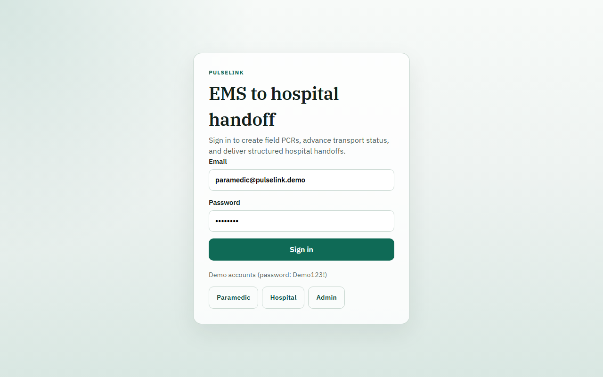
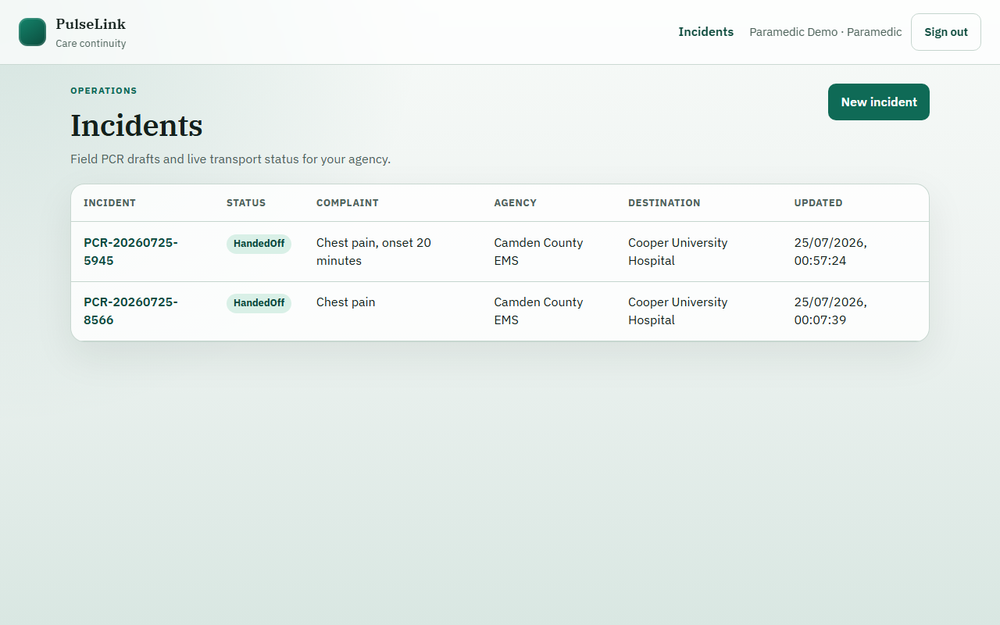
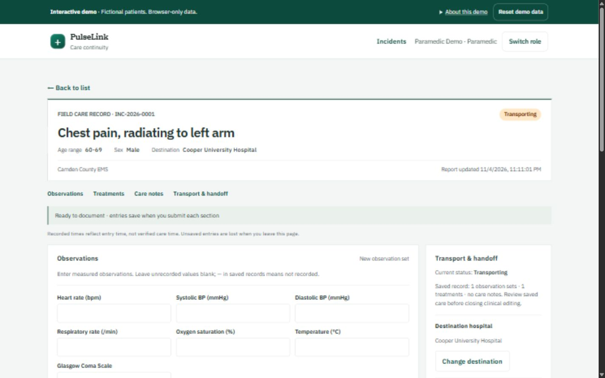
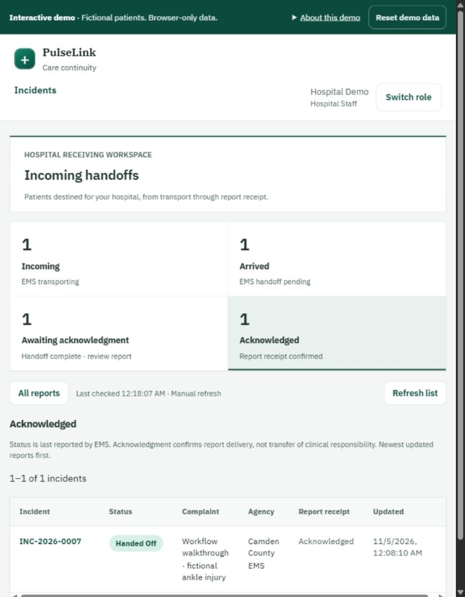

# PulseLink

EMS-to-hospital patient handoff platform.

Paramedics document a lightweight patient care report (PCR) in the field, advance transport status, and deliver a structured handoff summary to receiving hospital staff — with role-based access and an append-only audit trail.

## Live demo

### Try it in your browser

**[pulselink-demo.pages.dev](https://pulselink-demo.pages.dev)**

Pick Paramedic, Hospital staff or Admin with one click; no account or password. The full interface runs against seeded incidents, so you can advance transport status, record vitals and interventions, export a handoff, and compare what each role can see.

This build has **no server and no database**. It swaps the HTTP client for an in-browser adapter that applies the same rules as the API: the status machine, role visibility, version conflicts and idempotent intervention retries. Nothing you enter leaves your browser. Open an incident in two tabs and save in both to see a version conflict; **Reset demo data** in the banner restores the seed. The API's own behaviour is verified by the tests in [`backend/PulseLink.Tests`](backend/PulseLink.Tests), which CI runs against SQLite and SQL Server, and a test fails the build if the demo's status machine drifts from the server's.

Run it locally with `npm run dev:demo` in `frontend`, or build it with `npm run build:demo`.

The adapter demonstrates the workflow; it is not a replacement for API contract
tests. CI checks demo status rules, intervention replay identity, and incident
storage fallback. When incident storage fails, changes remain in memory for that
page only; reloads and other tabs cannot share those changes. Authentication still
requires browser storage. Demo storage schema changes reset synthetic incidents;
schema 2 resets older data to update intervention replay identity.

### Hosted deployment

**[pulselink.jayvir.dev](https://pulselink.jayvir.dev)**

The real stack: the API and the React production build are served from one Azure App Service running .NET 8, with Azure SQL as the database, reached through a Cloudflare Worker on a custom domain.

The landing page and the sign-in screen are public. **The clinical workspace requires an account, and the hosted demo credentials are not published here.** The seeded credentials below are for local runs only.

It runs on free tiers, so the first request after an idle period can take up to a minute while the app and its database resume; later requests are fast. Free quotas can interrupt it.

Use fictional patient information only. Deployment and configuration: [docs/azure.md](docs/azure.md).

## Care continuity at a glance

<picture>
  <source media="(prefers-color-scheme: dark)" srcset="docs/images/workflow-dark.svg">
  
</picture>

Rendered with [Pele](https://pele.run/) using PulseLink's green palette. [Diagram source and regeneration](docs/diagrams/README.md).

- **In the field:** start with the presenting complaint, choose a destination before transport, and record repeated observation sets, treatments, and an evolving care narrative.
- **At the hospital:** scan Incoming, Arrived, Awaiting acknowledgment, and Acknowledged queues; review the latest observation set, treatment details, and EMS narrative.
- **At handoff:** clinical editing closes. Hospital acknowledgment records who received the report and when; it does not represent transfer of clinical responsibility.
- **When work conflicts:** version checks require a deliberate reload and review. Unsaved clinical entries remain visible after a concurrent handoff, and uncertain treatment retries reuse the original request identity.

## Stack

- **Backend:** ASP.NET Core 8, C#, EF Core, ASP.NET Identity, JWT
- **Frontend:** React, TypeScript, Vite
- **Database:** SQLite locally by default; SQL Server is a second provider (see [docs/database.md](docs/database.md))
- **Tests:** xUnit
- **CI:** GitHub Actions
- **Hosting:** Azure App Service and Azure SQL, custom domain through a Cloudflare Worker (see [docs/azure.md](docs/azure.md)); browser-only demo build on Cloudflare Pages

## Quick start

### Prerequisites

- .NET 8 SDK
- Node.js 22.12+

### API

```bash
cd backend/PulseLink.Api
dotnet run
```

- API: http://localhost:5080
- Swagger: http://localhost:5080/swagger

### UI

```bash
cd frontend
npm install
npm run dev
```

- App: http://localhost:5173

Vite proxies `/api` to the API during local development.

### SQL Server (optional)

SQLite is the default. SQL Server is a second EF provider (`Database:Provider=SqlServer`) with its own migration set.

On Windows without Docker, LocalDB is the verified path:

```bash
sqllocaldb start MSSQLLocalDB
cd backend/PulseLink.Api
dotnet run --launch-profile http-localdb
```

Where Docker is available:

```bash
docker compose up -d
cd backend/PulseLink.Api
dotnet run --launch-profile http-sqlserver
```

`docker-compose.yml` is documented; it has not been run as part of the LocalDB verification. Provider settings, both `--context` migration commands, and startup-vs-deploy migrate: [docs/database.md](docs/database.md). List indexes: [docs/performance.md](docs/performance.md).

### Tests

```bash
dotnet test PulseLink.sln
```

The backend suite covers state transitions, role visibility, concurrent edits, receipt races, and narrative validation against SQLite and SQL Server. LocalDB tests skip when unavailable locally; the Windows CI job requires LocalDB, while Ubuntu runs SQLite.

```bash
cd frontend
npm ci
npm run build
npm run test:browser
npm run test:demo:browser
node --test tests/demo-*.test.mjs
```

Install Chromium once with `npx playwright install chromium` before browser checks. See [testing details](docs/testing.md).

## Seeded local users

| Role | Email | Password |
|------|-------|----------|
| Paramedic | `paramedic@pulselink.demo` | `Demo123!` |
| Hospital staff | `hospital@pulselink.demo` | `Demo123!` |
| Admin | `admin@pulselink.demo` | `Demo123!` |

See [docs/demo-walkthrough.md](docs/demo-walkthrough.md) for a guided local walkthrough.

## Screenshots

| Login | Paramedic incidents |
| --- | --- |
|  |  |

| Field care record | Hospital receiving queue |
| --- | --- |
|  |  |

## Core workflow

1. Create a draft incident with a chief complaint; destination can be chosen later.
2. Add repeated vitals and interventions, and update care notes (up to 2,000 characters). Recorded timestamps are entry times, not verified care times.
3. Advance `Draft → EnRoute → OnScene → Transporting → Arrived → HandedOff`. A destination is required before transport.
4. The destination hospital sees transporting and arrived patients and reviews the structured handoff.
5. After EMS completes handoff, hospital staff acknowledges report receipt. The original receipt remains unchanged on retry.
6. Authorized users can generate a FHIR-inspired JSON bundle via `GET /api/incidents/{id}/export`.

Unsaved entries are not persisted across navigation or reload. Over-limit narratives remain in the editor for shortening; the API and browser demo reject them without truncation. The export is a bounded integration example, not a complete EHR or certified FHIR interface.

## Project layout

```text
PulseLink/
  backend/
    PulseLink.Api/             HTTP + JWT + controllers
    PulseLink.Core/            Entities + status machine
    PulseLink.Infrastructure/  EF Core, Identity, seed data
    PulseLink.Tests/           Domain, data, and API tests
  frontend/                    React + TypeScript UI
  docs/                        Architecture, walkthrough, database, performance
```

## Design highlights

- Explicit incident status state machine with hospital-required gates
- Relational vitals/interventions (not a single JSON blob)
- Role-scoped queries (agency vs destination hospital)
- Audit events on create/update/status/export and hospital receipt
- Integration stub export for hospital systems

More detail: [docs/architecture.md](docs/architecture.md). List query indexes: [docs/performance.md](docs/performance.md).

## Deployment notes

The data model supports SQLite (local default) and SQL Server. The hosted demonstration serves the API and the React build from a single Windows App Service running .NET 8, with Azure SQL as its database and a Cloudflare Worker providing the custom HTTPS domain; `scripts/package-azure.ps1` builds the deployment ZIP. Required application settings, free-tier caveats and the custom-domain steps: [docs/azure.md](docs/azure.md). Provider settings and migrations: [docs/database.md](docs/database.md).
